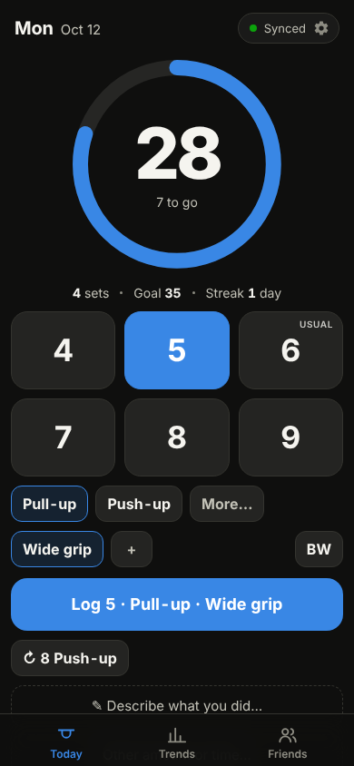
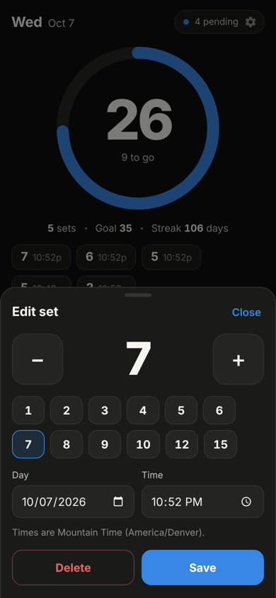
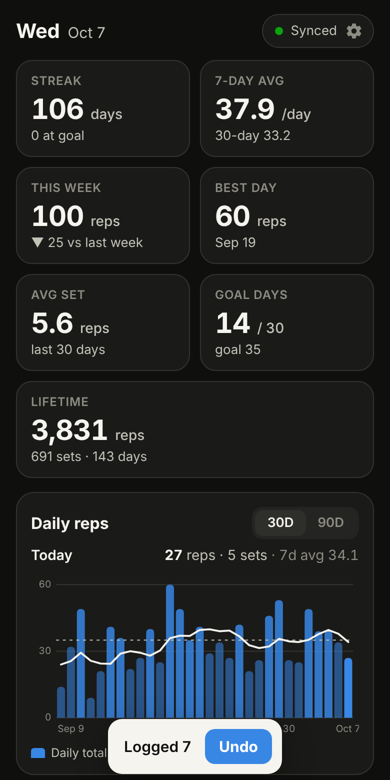
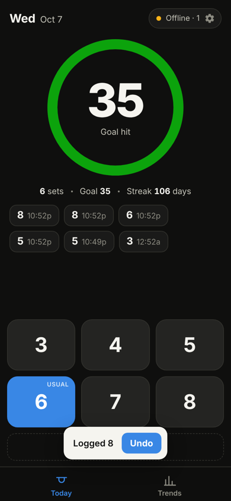

# Pull-ups

A personal pull-up log built for one-handed, one-tap use on a phone. Tap the number you just
did; the day's total updates instantly and syncs in the background. Daily totals, streaks and
trends live one tab over.

<p>
  
  
  
  
</p>

```
 phone / laptop (PWA)                         AWS
┌──────────────────────┐   HTTPS   ┌────────────────────────┐   OAC    ┌──────────────────┐
│ Preact app           │──────────▶│ CloudFront             │─────────▶│ S3: site bucket  │
│ localStorage replica │  /*       │  security headers      │          └──────────────────┘
│ outbox + sync loop   │           │                        │ OAC/SigV4┌──────────────────┐   ┌──────────────────────┐
│ service worker       │──────────▶│  /api/*  (no cache)    │─────────▶│ Lambda (Function │──▶│ DynamoDB: one table  │
└──────────────────────┘ /api/sync └────────────────────────┘          │ URL, AWS_IAM)    │   │ users, sets, day     │
   X-Pullup-Token header  /api/signup*                                 └──────────────────┘   │ totals, tokens,      │
   (one per device)       /api/passkey/*                                                      │ passkeys (PITR on)   │
                                                                                              └──────────────────────┘
```

Each person has their own account and log, made with a name and a passkey. Every set also
feeds per-day totals that a leaderboard can read in one query.

## Deploy

Deploys run from GitHub Actions (`.github/workflows/pipeline.yml`). Every push and PR runs
typecheck, tests, the build, and `terraform validate`. Every push to `main` then runs
`terraform apply`, uploads the site and invalidates CloudFront. No AWS keys are stored in
GitHub. The workflow assumes an IAM role through GitHub's OIDC token, and that role trusts
only `main` of this repo.

### One-time setup (about 5 minutes)

**1. Bootstrap AWS.** This creates the OIDC trust, the deploy role and the Terraform state
bucket from `infra/bootstrap.yaml`. Do it in **AWS CloudShell**, in the region you want
the app in:

```sh
# Upload infra/bootstrap.yaml via CloudShell's Actions → Upload file, then:
aws cloudformation deploy --stack-name pullups-bootstrap \
  --template-file bootstrap.yaml --capabilities CAPABILITY_NAMED_IAM
aws cloudformation describe-stacks --stack-name pullups-bootstrap \
  --query 'Stacks[0].Outputs' --output table
```

(Or use the console: CloudFormation → Create stack → Upload `infra/bootstrap.yaml`, and
tick the IAM acknowledgement.) If the account already has a GitHub OIDC provider, add
`--parameter-overrides CreateOidcProvider=false`. If you rename the repo, also pass
`GitHubOwner=… GitHubRepo=…`.

**2. Add three repository variables.** In the repo, go to Settings → Secrets and variables
→ Actions → **Variables**. These are not secrets; none of them grants access by itself.

| Variable | Value (from the stack outputs) |
|---|---|
| `AWS_ROLE_ARN` | `AwsRoleArn` |
| `AWS_REGION` | `AwsRegion` |
| `TF_STATE_BUCKET` | `TfStateBucket` |

**3. Deploy.** Actions → pipeline → **Run workflow** (or push to `main`). The run summary
prints the app URL. Until the variables exist, the deploy job is skipped, not failed.

**4. Make your account.** Passkeys need the custom domain (below), because each one is
bound to it for good. Sign-up is closed until you open it: set the repository variable
`SIGNUP_OPEN` to `true` and deploy. On iPhone, open the app URL in Safari, **Share → Add to
Home Screen**, then in the home-screen app go to **Settings → Account**, enter a name and
tap **Create account**. Face ID makes the passkey. Set `SIGNUP_OPEN` back to `false` if
nobody else should sign up yet.

From then on, everything happens inside the app. **Sign in with a passkey** signs any device
into your account, including after Safari's storage is wiped. **Add another device** makes
a 15-minute link for a device that can't use your passkey.

After that, merging to `main` is the deploy. An installed app picks up a new version the
next time it opens: the new service worker takes over in the background, and the page
reloads into it as soon as no sheet is open.

### Turning on M1's moving parts

Each lands separately; until it does, the app works without it.

- **Open sign-up**: set the repository variable `SIGNUP_OPEN` to `true`. Every passkey
  binds to the custom domain for good, so leave it unset until the app is on its final
  domain (or open it knowingly, for accounts you accept will be stranded at the move).
- **The empty-account sweep**: redeploy `infra/bootstrap.yaml` (it adds the deploy role's
  `SweepRules` permission to manage `pullups-*` EventBridge rules), then set `SWEEP_ENABLED`
  to `true`. Terraform adds a daily rule (09:30 UTC) that invokes the Lambda with
  `{"task":"sweep"}`; its log line says how many accounts it deleted and kept.
- **The sign-up rate rule**: the distribution's web ACL belongs to its CloudFront
  flat-rate plan, which Terraform leaves alone, so add this rule there in the console
  (CloudFront → the distribution → Security → the web ACL → Add rule → JSON):

  ```json
  {
    "Name": "pullups-signup-rate",
    "Priority": 0,
    "Statement": {
      "RateBasedStatement": {
        "Limit": 20,
        "EvaluationWindowSec": 300,
        "AggregateKeyType": "IP",
        "ScopeDownStatement": {
          "OrStatement": {
            "Statements": [
              { "ByteMatchStatement": { "SearchString": "/api/signup", "FieldToMatch": { "UriPath": {} }, "TextTransformations": [{ "Priority": 0, "Type": "NONE" }], "PositionalConstraint": "STARTS_WITH" } },
              { "ByteMatchStatement": { "SearchString": "/api/passkey/login", "FieldToMatch": { "UriPath": {} }, "TextTransformations": [{ "Priority": 0, "Type": "NONE" }], "PositionalConstraint": "STARTS_WITH" } },
              { "ByteMatchStatement": { "SearchString": "/api/links/resolve", "FieldToMatch": { "UriPath": {} }, "TextTransformations": [{ "Priority": 0, "Type": "NONE" }], "PositionalConstraint": "EXACTLY" } }
            ]
          }
        }
      }
    },
    "Action": { "Block": { "CustomResponse": { "ResponseCode": 429 } } },
    "VisibilityConfig": { "SampledRequestsEnabled": true, "CloudWatchMetricsEnabled": true, "MetricName": "pullups-signup-rate" }
  }
  ```

  20 requests per 5 minutes per IP covers a sign-up (2 requests), a sign-in (2) and a
  landing page (1) many times over. To check it, run `curl -s -o /dev/null -w '%{http_code}\n'
  -X POST https://<domain>/api/links/resolve -d '{"code":"x"}'` 25 times in a row; the last
  few should print 429.
- **Associated Domains for the iOS app**: set `APPLE_APP_ID` (`<TeamID>.<bundle id>`); the
  build then writes `/.well-known/apple-app-site-association` and the deploy serves it as
  `application/json`.

### What the CI role can do

The deploy role (`github-deploy-pullups`) can only touch resources named `pullups-*`
(site bucket, Lambda, log group) and the `pullups` table, plus CloudFront, which has no useful
resource-level scoping. It can create IAM roles only when they carry the
`pullups-lambda-boundary` permissions boundary. The boundary caps any role it creates at
what the API Lambda needs: item reads and writes on the table, and writing logs. The
deploy role can manage the table but not read or write its items.
Without the boundary, "can create a role and a Lambda" amounts to "can become admin". The
role's own name sits outside the `pullups-*` namespace, so it cannot edit itself.

The table has `prevent_destroy` in Terraform and deletion protection in AWS, so a bad
change can't plan it away, and the deploy role has no `DeleteTable` permission anyway.

### Deploying from a laptop instead

```sh
export AWS_REGION=us-west-2 TF_STATE_BUCKET=<TfStateBucket output>   # plus AWS credentials
scripts/deploy.sh            # check, build, terraform apply, upload, invalidate
scripts/deploy.sh --site     # skip terraform; just rebuild and upload the site
```

This uses the same remote state as CI, so the two never disagree.

**Custom domain** (needed for passkeys, so for accounts): the domain's zone must be a Route 53 public hosted zone, with
its name servers set at the registrar. Set the repository variables `DOMAIN_NAME` (e.g.
`pullups.example.com`) and `DNS_ZONE_NAME` (`example.com`), and pass the matching
`DnsZoneId` and `DomainName` to the bootstrap stack so the deploy role may edit just those
records. Terraform then issues the us-east-1 ACM certificate, validates it through DNS, and
points A/AAAA alias records at the distribution. Locally, pass the same two values as `-var`s.

## How auth works

There are two independent locks on the API, and no AWS credential ever reaches a browser:

1. **Only CloudFront can call the Lambda.** The Function URL uses `AWS_IAM` auth, and the
   only principal allowed to invoke it is the CloudFront distribution, which signs each
   request with SigV4 through Origin Access Control. Hitting the raw `*.lambda-url…` host
   directly returns 403. (For POST bodies OAC needs the payload hash, so the client sends
   `x-amz-content-sha256`; that's computed with WebCrypto and isn't a secret.)
2. **Only members get past the Lambda.** Every authenticated request carries
   `X-Pullup-Token`, a 256-bit random session token issued to that one device when it signed
   in. The table stores only its SHA-256 digest (`T#<digest>` → user id), so a leaked table
   backup grants no access. The Lambda caches lookups for a minute.

A custom header is used instead of `Authorization` because OAC replaces `Authorization`
with its own signature on the way to the origin.

**Passkeys.** An account is a display name and one or more passkeys, with no email and no
password. Sign-up is `/api/signup/options` (the server makes a user id and a challenge that
holds the name and zone) then `/api/signup`, which verifies the new passkey with
`@simplewebauthn/server` (attestation `none`, user verification required) and writes the
profile, the passkey and the device's session token in one transaction, so no account
exists without a passkey. **Sign in with a passkey** asks for any discoverable passkey on
the domain; the response carries the user id as its user handle, which finds the stored
public key. A signed-in device can add more passkeys, which is how an account from before
passkeys gets its first. Challenges are 32 random bytes, stored as digests for 5 minutes and
consumed by a conditional delete, so a response can't be replayed.

Every passkey belongs to the relying-party id, the custom domain (`RP_ID`, set from
`domain_name`). Without a custom domain passkeys are off, rather than bound to a
cloudfront.net name. **Sign-up is closed** unless the Terraform variable `signup_open` is
true (the `SIGNUP_OPEN` repository variable): a passkey can't move to a new domain, so
nobody but the operator should register one before the app is on its final domain.

**Device links.** `POST /api/join { code }` redeems a single-use, 15-minute link that signs
a device into the account that made it, for a device that can't use the passkey. Redeeming
is one transaction that deletes the link (conditional on it still existing) and creates the
token, so two devices racing for one link can't both win. Expiry is checked on redeem;
DynamoDB TTL only tidies up later. The friend invites that once made new accounts are
retired; one still outstanding is refused.

The site bucket is fully private (Block Public Access, owner-enforced objects). The
Lambda's role can only read and write items in the one table.

### Managing access

Run these from AWS CloudShell (upload `scripts/invite.sh`) or anywhere else that has AWS
credentials. They need only the AWS CLI and openssl.

```sh
scripts/invite.sh users          # list accounts: id and name
scripts/invite.sh device <id>    # lost every device and passkey? a link back into that account
scripts/invite.sh revoke <id>    # sign every device of that account out and delete its passkeys
```

A revoked device stops syncing within 60 seconds and shows **Signed out**. It keeps
logging locally, and those sets are pushed once it signs in again.

## Data layout and sync

**One DynamoDB table** (on-demand) holds everything. The key layout is documented at the
top of `src/lambda/dynamodb.ts`:

| pk | sk | item |
|---|---|---|
| `U#<userId>` | `P` | profile: name, `timeZone` (IANA; absent means `America/Denver`), daily goal, a clock per editable field |
| `U#<userId>` | `E#<id>` | one set, plus `serverWrittenAt`, the server time it was written |
| `U#<userId>` | `D#2026-10-08` | that user's day total: ring reps, sets, best set, hold seconds, and the same per exercise (`byExercise`) |
| `U#<userId>` | `A#<key>` | a created exercise or variation that user made or logs to |
| `X#<exerciseId>` | `X` / `V#<variationId>` | a created exercise, or a variation on an exercise |
| `U#<userId>` | `K#<credentialId>` | a passkey: public key, sign count, label |
| `U#<userId>` | `T#<digest>` | a session token, from the account's side |
| `U#<userId>` | `L` | the user's friend link |
| `U#<userId>` | `F#<friendId>` | a friendship, written on both sides |
| `U#<userId>` | `G#<challengeId>` | a challenge membership, with the member's own link |
| `U#<userId>` | `R#<fromId>` / `S#<toId>` | a friend request, on the receiver's and the sender's side |
| `U#<userId>` | `RQ#<day>` | friend requests sent that day |
| `G#<challengeId>` | `G` / `M#<userId>` | a challenge, and its members |
| `T#<digest>` | `T` | session token → user id |
| `I#<digest>` | `I` | a device link, or a shared link (`friend` or `challenge`) with its open and join counters |
| `C#<digest>` | `C` | pending WebAuthn challenge |
| `W#<day>` | `U#<userId>` | when the empty-account sweep looks at an account (sign-up + 30 days) |

Each set is stored as:

```json
{ "id": "9f2c…", "doneAt": 1791489600000, "reps": 6, "updatedAt": 1791489600000 }
{ "id": "7a1d…", "doneAt": 1791489600000, "exerciseId": "front-lever", "variationIds": ["tuck"], "holdSeconds": 45, "updatedAt": 1791489600000 }
```

`doneAt` is when you did the set (it decides the day). `updatedAt` is the version clock.
A deleted set stays as a tombstone with `"deleted": true` so the delete itself can sync.
A set with no `exerciseId` is a pull-up, which is how every set from before v2 reads. A
set has exactly one of `reps` (a count in its exercise's unit) and `holdSeconds`. Built-in
exercises and variations are in `src/shared/catalog.json`; the full rules are in
`docs/v2-design.md`.

**No lost writes, by construction.** The entry set is a state-based CRDT: per-entry
last-writer-wins with a deterministic tiebreak (delete beats edit on a same-millisecond tie).
Merging is commutative, associative and idempotent, so devices converge regardless of
order, duplicates or retries. On the server, each pushed set is merged against the stored
version and written with a **conditional put** on that version's `serverWrittenAt`, which strictly
increases per set, so a concurrent writer is always detected. When one is, the Lambda
re-reads, re-merges and retries. A test fires 12 concurrent pushes through an
interleaving store to prove it, and the same suite runs against DynamoDB Local in CI.

**Day totals for the leaderboard.** After writing, the Lambda recomputes the total for
every day (in that user's zone) a push touched, both the old and new day when a set moves. It sums that
day's sets through the `by-done-at` index and writes the result conditional on the total's
version, so a stale recompute can't overwrite a newer one. Day totals carry `monthPk` =
`M#2026-10`, which puts every user's days for a month in the `by-month` GSI, so a board
for any period is one query. A retried push recomputes even when its sets were already
written, which heals a request that died between the two steps.

**Delta sync.** `POST /api/sync { protocolVersion: 2, pushedEntries, pushedDefinitions, sinceCursor }` pushes the outbox and
returns every set of yours written after the cursor (queried via the `by-server-written-at` index), plus
a new cursor. The cursor deliberately trails the server clock by 30 s, longer than the
Lambda timeout, so a write that was stamped but still in flight can never slip behind
it. The cost is that a recent write is sent back once more, which the merge ignores. A
fresh device sends `sinceCursor: 0` and gets everything in one round trip.

**Created exercises and variations** travel in the same request, merged before the sets
so a set can log to an exercise made offline a moment ago. Only the creator can rename one,
and its measure and unit never change. Every response carries the definitions you've made
or logged to, so a rename reaches all your devices.

**The protocol gate.** A request without `protocolVersion: 2` gets **426**. A client that
predates a field strips it when it normalizes a set, so its edit would silently undo
another client's change. A turned-away PWA keeps its outbox and shows *Update*; once the
new build's service worker takes over, the page reloads into it and the queued sets go up.

**Backups.** Point-in-time recovery is on, so the table can be restored to any second
in the last 35 days.

## Offline behavior

- **Every tap is local first.** The entry is written to the in-memory replica and
  `localStorage` synchronously, added to the outbox, and rendered. The network is never
  on the tap path.
- **Taps are batched.** A sync fires 1.2 s after the last change, so a burst of edits is one request.
- **Retries back off** at 2 s, 4 s, 8 s and so on, capped at 5 minutes. A sync is also
  kicked when the app comes to the foreground, when the browser reports `online`, and
  every minute while visible. iOS has no Background Sync API, so these opportunistic
  triggers are what it gets.
- **Edits made during an in-flight sync stay queued.** An entry leaves the outbox only
  if the version the server acknowledged is still the latest local one.
- **The app shell is precached** by a small hand-written service worker, so the app opens
  with no signal at all. The `/api` path is never cached. When a deploy's new worker takes
  over, the page reloads into it right away (after any open sheet closes), rather than
  on the following launch. Every tap is already saved, so the reload loses nothing.
- The pill in the top right always says where things stand: *Synced*, *3 pending*,
  *Offline · 3*, *Signed out*, or *Sign in*.
- **Logging works before you sign in.** Sets logged without an account stay on the device,
  and they're pushed to your account the moment you sign up or sign in. Signing in as a
  different account than before drops the old account's synced sets from the device.

If `localStorage` is wiped, **Sign in with a passkey** (or a device link from another of
your devices, or from `invite.sh device`) pulls the full history back. Anything that never synced before the
wipe is gone, which is why the outbox count is always visible.

## Design decisions

**Leaderboards rank on the client.** `/api/leaderboard` returns raw day totals for you and
your friends, and `src/shared/boards.ts` ranks them by a board spec (metric, exercise,
period) in each person's own zone, so a ranking change is a client release. The Friends tab
leads with the board; tapping someone opens their profile.

**Challenges are groups around one exercise.** Start one from the Friends tab on any
exercise you can see, for up to 62 days with an optional group target. Every member has
their own link; opening one joins the challenge, befriends whoever shared it, and adopts the
exercise so everyone logs to the same id. The board leads with the group total and ranks
members inside it. Members see each other's names and that exercise's totals in the window,
cut down on the server, and nothing else.

**Friend requests come from challenges.** Anyone you share a challenge with has **Add** on
the board and under "People from your challenges". A request names the challenge, arrives in
the next sync (Friends gets a badge), and is accepted in one tap. A decline is silent: the
sender keeps seeing "Requested".

**Friends are made by links.** Your friend link (Friends tab, with a QR code) is reusable
until you make a new one; opening it signed in adds you in one tap, and signed out it asks
for a name and a passkey and makes the account and the friendship together. The URL carries
only a code, in the fragment (`#join=<code>`), so it never reaches CloudFront logs.

**Passkeys + per-device tokens, not Cognito or Sign in with Google.** No email or password
exists to collect, leak or reset, and a passkey syncs through iCloud Keychain or Google
Password Manager, so a new phone signs straight back in. Someone who loses every device and
their password manager can be let back in with `invite.sh device`. This keeps the browser
side to one header, and the API stays a Function URL behind CloudFront OAC: it costs nothing
idle, it's same-origin (no CORS), and all merge logic runs server-side where conditional
writes make it race-free.

**DynamoDB, not S3.** This started as one JSON file per month in S3, which was ideal for a
single person. A leaderboard needs totals across users, which in S3 means reading every
user's files on every view. In DynamoDB each set is its own item, so a push writes only
what changed and a sync reads only what's new. The per-day totals sit in an index that
answers "everyone's October" with one query.

**Days are computed in each account's own time zone**, an IANA name on the profile, via
`Intl.DateTimeFormat`. A new account takes the zone of the device that joins, and every
account made before zones were per user has none stored, which means `America/Denver`, so
its stored day keys never move. A device that hasn't joined uses its own zone. Day keys
are `YYYY-MM-DD` strings with pure calendar arithmetic, so the 23- and 25-hour DST days
count as one day each. Sets entered by hand (“Other amount or time…”) take a wall-clock
time in the account's zone. A time skipped by spring-forward moves an hour later, and the
repeated fall-back hour resolves to its first occurrence. The UI rolls over at midnight in
that zone even if the app is left open.

**Preact (~4 KB gz) rather than vanilla or React.** The UI has several views, sheets and
derived stats that re-render together. Preact gives components and hooks for the price of
a small image. Bundled with **esbuild**: one dependency, a 40 KB JS / 14 KB CSS build, no
config files.

**Hand-rolled SVG charts, no chart library.** Two charts don't justify a 60+ KB dependency.
The bar chart shows daily totals with the goal as a dashed rule and a 7-day trailing mean
as a line. Tap any bar for a readout, with a legend because there are three marks. The
heatmap uses one sequential blue ramp, bucketed by fraction of your goal, so its colors
mean the same thing however your volume grows.

**Logging UX.**
- **Six big buttons for 3–8** in the bottom thumb zone, since that covers your range.
  Your most frequent count over the last 30 days is highlighted as **usual**.
- **One tap = one logged set**, with haptic feedback where supported and an **Undo**
  toast for 5 seconds.
- **A second tap within 600 ms is ignored.** A real set takes longer than that; a
  fat-finger double-tap doesn't.
- **"Other amount or time…"** opens a stepper with any rep count plus a date/time, for
  odd sets or ones you forgot to log.
- **Tap any of today's set chips to edit or delete it.** Delete has its own undo.
  Past days are editable from **Trends → History**.

**Stats shown.** Today's total against the goal ring is the headline, with set count and
current streak under it. Trends has:
- **Streak**: consecutive days with any sets, plus days at goal. An empty *today* doesn't
  break the streak until midnight.
- **7- and 30-day averages over completed days.** Today's partial total would drag them
  down all morning. Days before your first set aren't counted, so averages are honest from
  day one.
- **This week vs. last week to the same weekday.** Monday to Thursday is compared with
  last Monday to Thursday, not the whole of last week.
- **Best day**, **average set size**, **goal days out of 30**, and **lifetime totals**.
- **A 30/90-day chart, a 26-week heatmap, and a tappable 30-day history list.** The list
  doubles as the accessible table view of the chart data.

**Daily goal, time zone and name live on the profile** (`POST /api/profile`), each its own
last-writer-wins field, so every device agrees. Edits apply at once and are sent before the
next sync, so they work offline like sets do. Until an account's goal is first set, each
device shows its own (default 35), so nobody's ring moved when this shipped. Changing the
zone re-keys the last 62 days of totals; older days keep theirs.

**Dark-first** (gym lighting, OLED), with a light theme that follows the OS. System
rounded font with tabular numerals, so digits don't jump as totals change.

**Cost.** Effectively zero at this volume. A few hundred Lambda invocations and on-demand
DynamoDB requests a day sit inside the free tiers, and PITR on a table this small is
fractions of a cent.
CloudFront's always-free tier covers it. To bound worst-case cost from someone hammering
the URL with bad tokens, set `lambda_reserved_concurrency` (e.g. `2`). It defaults to off
because new AWS accounts often can't reserve concurrency.

## Development

```sh
npm install
npm run dev        # builds, then serves on http://localhost:5173 with the real API handler
                   # over an in-memory db saved to .devdata/, sign-up open; prints a device
                   # link for the seeded "Dev" account. Passkeys need a domain, so they work
                   # on localhost but not on 127.0.0.1.
npm test           # vitest (DynamoDB adapter tests skip without DYNAMODB_ENDPOINT)

docker run --rm -p 8000:8000 amazon/dynamodb-local
DYNAMODB_ENDPOINT=http://localhost:8000 npm test    # also runs them against DynamoDB Local
npm run typecheck
npm run check      # both
npm run build      # dist/site (static) + dist/lambda/index.js
```

The service worker is skipped on `localhost` so dev reloads aren't served stale.
`scripts/make-icons.py` regenerates the PNG icons (needs Pillow).

### Tests

Behavior that every client must agree on (merge, day keys, validation, stats) lives in
shared JSON fixtures under `test/fixtures/`, described in its README. The Swift client will
run the same files. They include a **v1 golden history** whose expected stats and stored day
totals were generated by the v1 code and are never regenerated.

- `test/time.test.ts`, `test/model.test.ts`, `test/stats.test.ts`: run `days.json`,
  `merge.json`, `validation.json` and `stats.json`. Day boundaries in Denver, London, Sydney and Kolkata,
  evening sessions that cross UTC midnight, month and year edges, both DST transitions,
  wall-clock → instant conversion; LWW tiebreaks through every v2 field, v1 → v2 shapes,
  convergence in every merge order, normalization and input validation against the
  catalog; the ring rule (only rep-unit counted sets); daily totals with tombstones, streak rules,
  completed-day averages, week-to-date comparison, best day, empty history.
- `test/server-sync.test.ts`: the v1 golden history's stored day totals, delta sync and
  the cursor lag (including a write that commits after a later sync started), day totals through edits, deletes and moves, healing
  a total on retry, **12 concurrent writers losing nothing**, concurrent edit vs. delete,
  stale recomputes, the protocol gate, v2 fields end to end, per-user isolation, device links (single-use,
  expiry), and bad input.
- `test/passkeys.test.ts`: sign-up, sign-in and adding passkeys through the real router and
  real WebAuthn verification, driven by a software authenticator (`test/softAuthenticator.ts`:
  P-256 keys, CBOR attestation objects, signed assertions). It covers wrong origins and
  domains, missing user verification, replays, expired and cross-purpose challenges, forged
  signatures, a counting security key and a cloned one, closed sign-up, the operator's
  pre-passkey account getting its first passkey, and retired friend invites.
- `test/dynamodb.test.ts`: the DynamoDB adapter against DynamoDB Local. It covers the
  v1 golden history, the conditional puts, both LSIs across query pages, the month GSI,
  concurrent syncs, three devices racing to redeem one device link or take one challenge,
  account creation, and passkey sign-up and sign-in through the router.
- `test/friends.test.ts`: friend links made on first ask (once, under a race), resolved by
  anyone to just the kind and the inviter's name, redeemed into a two-sided friendship
  once, open and join counters, your own link, rotation killing the old code, 404 for
  unknown, junk, device, pre-passkey and orphaned codes, removing friends without probing
  for accounts, and signing up through a link (friendship and `joinedVia` in the same
  write, kept through profile edits; a link that dies mid-sign-up).
- `test/boards.test.ts`: runs `boards.json` through `evaluateBoard` and `groupTotal`, and
  checks each member's period window in their own zone.
- `test/leaderboard.test.ts`: `/api/leaderboard` returns you and your friends with day totals
  in the window (the operator's v1 day total included) and the created exercises they name,
  never a stranger; window checks; `/api/profile/view` for a friend, for the operator's
  pre-v2 history, and the same 404 for a stranger, a missing account, junk and an ex-friend.
- `test/challenges.test.ts`: creating (visible exercise, window, target), resolving a
  challenge link to the exercise and group numbers with no names, redeeming into
  friendship + membership + adopted exercise once, joining through any member's link,
  sign-up into a challenge, the 200 cap, link expiry a week after the end, the board's
  projection (a non-friend member's other exercises, ring reps, holds, zone and days
  outside the window never leave the server), the same 404 for strangers, leaving, and the
  list.
- `test/requests.test.ts`: friend requests between fellow members arriving in the sync
  response and on boards, accepting, mutual requests, a silent decline (everything the
  sender can observe is identical before and after, and re-sending reaches nobody),
  cancelling, the same 404 for strangers, missing accounts, yourself and other challenges,
  eligibility after a challenge ends and after leaving, the operator's account, and the
  50-a-day cap.
- `test/sweep.test.ts`: the empty-account sweep deletes an account still empty 30 days
  after sign-up with its passkeys, tokens and friend link, keeps one with entries, friends,
  a challenge or an adopted exercise, never touches the operator's pre-passkey account,
  looks at each account once, catches up on missed days, and stops inside its time budget.
- `test/definitions.test.ts`: created exercises and variations through `/api/sync`: made
  offline and logged to in one push, reaching other devices, staying private until logged
  to, creator-only renames, fixed measure and unit, and the measure check.
- `test/profile.test.ts`: `/api/profile` on a pre-v2 profile, per-field last-writer-wins
  across devices, concurrent edits, re-keying 62 days on a zone change (and healing a
  retried one), and no rebuild for an edit that lost.
- `test/tracker.test.ts`: the client replica. It covers persistence before network,
  debounced batching, an edit during an in-flight push, two devices converging after
  offline edit/delete conflicts, a fresh device pulling history, the cursor and its reset
  on account change, dropping another account's synced sets on a switch, sets logged before joining, undo before first sync, backoff,
  stopping when signed out or turned away by the protocol gate, and editing a v2 set
  without losing the fields this UI doesn't show.
- `test/handler.test.ts`: the Lambda entrypoint. It covers Function URL events, base64
  bodies, token-lookup caching, and opaque 500s.

## Layout

```
src/shared/   time.ts (calendar in any zone), model.ts (entries + CRDT merge), stats.ts
src/lambda/   handler.ts → http.ts (routes) → sync.ts (merge + day totals), passkeys.ts, accounts.ts (device links)
              → db.ts (interface + in-memory) / dynamodb.ts
src/app/      tracker.ts (local replica + sync engine), api.ts, App/Today/Trends/sheets/charts, sw.ts
src/dev/      local server used by `npm run dev`
infra/        Terraform: site bucket, DynamoDB table, CloudFront + OACs, Lambda + URL
              bootstrap.yaml: one-time CloudFormation for CI (OIDC role, state bucket, boundary)
scripts/      build.mjs, dev.mjs, deploy.sh, tf-init.sh, publish-site.sh, invite.sh, make-icons.py
.github/      pipeline.yml: check on every push/PR, deploy on main
```
